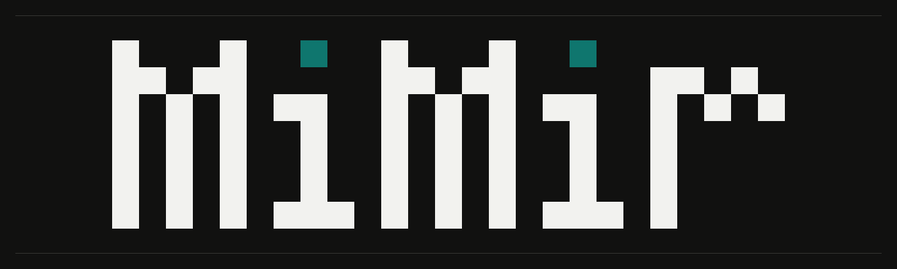
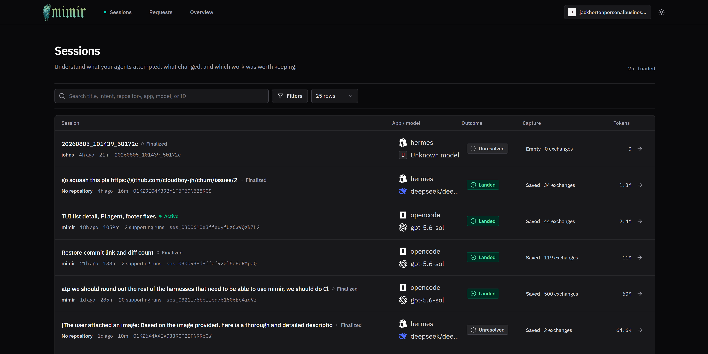
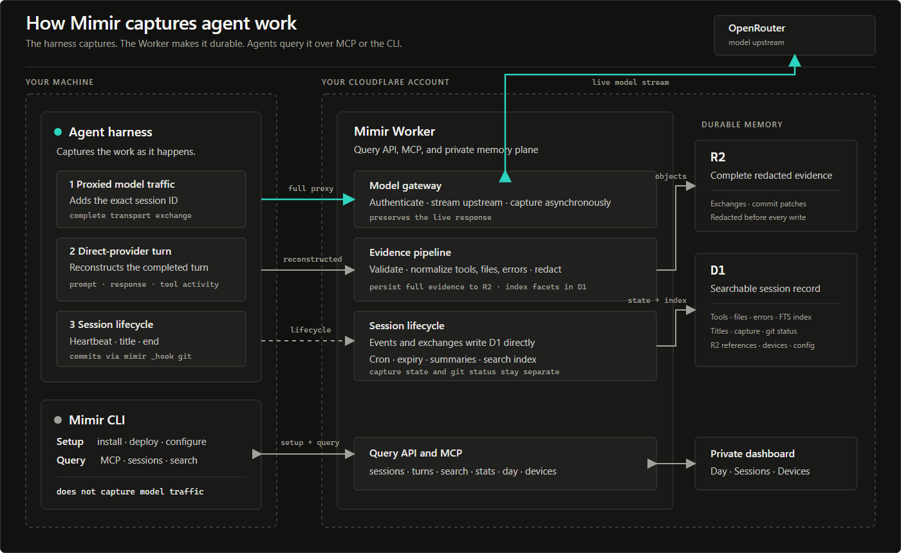

<p align="center">
  
</p>

# Private memory for coding agents

Mimir records every coding-agent session automatically: what was asked and
done, which models, files, and errors were involved, and which commits were
made and pushed. Your agents query that memory through MCP, native tools, or
the CLI to answer "how did I fix this before?" in one or two calls. The Worker,
storage, and private dashboard run inside your Cloudflare account.

## Install

Install the latest checksum-verified release and select the coding agents you
use.

macOS and Linux:

```bash
curl -fsSL https://raw.githubusercontent.com/cloudboy-jh/mimir/master/install.sh | sh
```

Windows PowerShell:

```powershell
irm https://raw.githubusercontent.com/cloudboy-jh/mimir/master/install.ps1 | iex
```

## Set up

A fresh deployment needs a Cloudflare account, an OpenRouter API key, and
Node.js 22 with npm. You do not need Bun, Go, or a source checkout.

```bash
mimir setup
```

Setup deploys the embedded Worker and dashboard, provisions D1 and R2,
registers this machine, and stores the OpenRouter key as a Worker secret
(from `OPENROUTER_API_KEY`, an existing secret, or a masked prompt). If the
installer did not enroll your agent, run `mimir install --harness <id>`.

Apply the activation action for your agent (see the table below), then check
everything:

```bash
mimir doctor --json
```

Start a normal session in your agent, then confirm it was saved:

```bash
mimir sessions --json
mimir session status <id>
```

Never use a paid model call just to test connectivity. See
[installation](docs/installation.md) for every path and recovery step.

## Use the memory

Mimir captures on its own; agents never record, mark, or end anything. They
read memory when prior work would help. Ask your agent things like:

- "How did I fix the token validation error last time?"
- "What did I do in this repo last week, and what got pushed?"
- "Chart my sessions this week by repo."

Claude Code, Codex, and Cursor get an MCP server named `mimir`; OpenCode and
Hermes get native `mimir_*` tools; Pi and Oh My Pi run the CLI with `--json`.
All of them return the same data:

```bash
mimir search "token validation" --json
mimir sessions --repo mimir --from 7d --git-status pushed --json
mimir stats --by repo --from 7d --json
mimir session <id> --json
```

Each session carries a **capture status** (Saved, Pending, Partial, Failed,
Empty) that says whether Mimir stored it, and a **Git status** (`none`,
`committed`, `pushed`) derived from captured commits. To recover local Pi or
OpenCode history, run `mimir import` or `mimir backfill`. See the
[CLI reference](docs/cli.md).

## Dashboard

Run `mimir access` once to put the dashboard behind Cloudflare Access, then
`mimir dashboard`. It has three pages: **Day** draws one calendar day as a
donut of workstreams with their sessions and commits; **Sessions** lists and
filters sessions, and each session page shows its summary, conversation,
commits with patches, files, and errors; **Devices** lists your machines with
their tailnet status and lets you rename or revoke them.



## What gets captured

| Agent | Integration | Activate | Evidence |
| --- | --- | --- | --- |
| OpenCode | `~/.config/opencode/plugins/mimir.ts` | Restart OpenCode | Proxy exchanges for OpenRouter; bounded reconstructions for direct providers |
| Pi | `~/.pi/agent/extensions/mimir.ts` | Restart Pi | Proxy exchanges for OpenRouter; bounded reconstructions for direct providers |
| Oh My Pi | `~/.omp/agent/extensions/mimir.ts` | Restart Oh My Pi | Proxy exchanges for OpenRouter; bounded reconstructions for direct providers |
| Hermes | `~/.hermes/plugins/mimir/` | Restart Hermes | Proxy exchanges for OpenRouter; bounded request/response and tool reconstructions for direct providers |
| Claude Code | `~/.claude/skills/mimir/` (plugin, hooks, MCP) | `/reload-plugins` or restart | Bounded prompt/response reconstructions |
| Codex | `~/.agents/plugins/plugins/mimir/` (plugin, hooks, MCP) | Restart Codex | Bounded prompt/response reconstructions with token usage |
| Cursor | `~/.cursor/hooks.json`, plus `~/.cursor/mcp.json` when absent | Open or continue a session | Bounded prompt/response reconstructions |

Every integration also reports session lifecycle and captures commits through
`mimir _hook git`. `x-mimir-session` is the authoritative session boundary;
traffic without it is grouped by repository, harness, and device with an
inactivity gap. The Worker redacts before writing exchanges and patches to R2;
redaction reduces accidental retention but cannot guarantee every secret is
removed. Run `mimir harness` to see your integrations and paths.



There is no Mimir account or hosted backend. Machine requests use per-machine
bearer tokens; the deployed dashboard requires verified Cloudflare Access
JWTs. Mimir uses your account's shared Cloudflare allowances.

## More paths

- **Another machine:** install Mimir there and run `mimir login`
  ([direct URL and token](docs/installation.md#direct-url-and-token) also work).
- **Upgrade:** `mimir update`, then `mimir deploy` to apply the bundled Worker,
  dashboard, and migrations ([operations](docs/operations.md#update)).
- **Other model clients:** `mimir connection` prints proxy URLs, credential
  sources, and metadata headers.
- **Operations:** [deploy, diagnose, update, Access, devices](docs/operations.md)
  · [troubleshooting](docs/troubleshooting.md)
- **Reference:** [CLI](docs/cli.md) · [APIs, MCP, storage, security](docs/Spec.md)
  · [session lifecycle](docs/session-lifecycle.md) · [product](docs/PRODUCT.md)
  · [dashboard design](docs/DESIGN.md)
- **Harness details:** [OpenCode](docs/opencode-capture-setup.md) ·
  [Hermes](docs/hermes-capture-setup.md)
