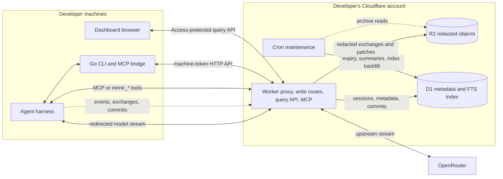

# Mimir v2 Implementation Specification

This document describes the current implementation. Product intent is defined
in [`PRODUCT.md`](PRODUCT.md), dashboard visual direction in
[`DESIGN.md`](DESIGN.md), and installation and usage in the root
[`README.md`](../README.md).

## 1. Purpose

Mimir is a self-hosted memory plane for one developer working across coding
agents, repositories, and machines. It captures model traffic and harness
activity as sessions and lets agents query that history in one or two calls
through MCP, native harness tools, or the CLI. A small private dashboard shows
the same data to the developer.

The deployment runs in the developer's Cloudflare account. Mimir has no hosted
backend, account system, multi-user tenancy, or shared memory service.

## 2. System Boundary

One Cloudflare Worker provides:

- OpenAI Chat Completions and Anthropic Messages proxy routes
- Machine write routes for session events, reported exchanges, and Git commits
- The query API (`/api/*`), also served as MCP (`/mcp`)
- The same query API for the dashboard under Cloudflare Access (`/dashboard/api/*`)
- Static Vue dashboard assets
- A scheduled (cron) handler for session expiry, summaries, and search indexing

The Worker uses:

- **OpenRouter** as the only model upstream
- **D1** for sessions, exchange metadata, the FTS5 search index, Git commit
  metadata, devices, configuration, and machine-token hashes
- **R2** for complete redacted exchanges and redacted commit patches
- **Cloudflare Access** for deployed dashboard authentication

The Go binary provides installation, setup, login, deployment, diagnostics,
local-history import, the `mimir _hook` adapters, the stdio MCP bridge, and
the read commands. The Worker HTTP API is canonical; the CLI, MCP bridge,
harness plugins, and dashboard are clients of it.



## 3. Authentication

### 3.1 Machine Requests

Proxy, write, query, MCP, and CLI requests use a per-machine token supplied as
either:

```http
Authorization: Bearer <token>
```

or:

```http
x-api-key: <token>
```

Machine-token routes are `/api/*`, `/mcp`, `/sessions/*`, `/whoami`,
`/machine/*`, `/config`, `/reconcile`, `/integrations/*`, and `/v1/*`.

Each machine gets an independent random 32-byte token. D1 stores only its
SHA-256 hash, label, creation time, installation association, and revocation
state. The plaintext token is stored locally in `~/.mimir/token`, or under
`$MIMIR_HOME`, with restrictive permissions.

Before forwarding model requests, the Worker removes machine credentials and
all `x-mimir-*` metadata, then authenticates upstream using the
`OPENROUTER_API_KEY` Worker secret.

### 3.2 Dashboard Requests

Deployed `/dashboard/auth` and `/dashboard/api/*` routes require a verified
`Cf-Access-Jwt-Assertion`. Verification uses:

- `DASHBOARD_ACCESS_AUD`
- `DASHBOARD_ACCESS_TEAM_DOMAIN`

Requests to `localhost` or `127.0.0.1` bypass Access with a marked
development identity. Static SPA assets are served separately from dashboard
API authentication. Browser code never receives a machine token.

Setup can configure the Cloudflare Access application when supplied an API
token. `mimir access` can create, repair, or attach an existing application
later.

## 4. HTTP API

### 4.1 Proxy

| Method | Route | Behavior |
| --- | --- | --- |
| `POST` | `/v1/chat/completions` | OpenAI-style Chat Completions proxy. |
| `POST` | `/v1/messages` | Anthropic-style Messages proxy. |
| `GET` | `/v1/models` | OpenRouter model-list pass-through. |
| `GET` | `/v1/key` | OpenRouter API-key metadata pass-through. |
| `GET` | `/v1/credits` | OpenRouter account-credit pass-through. |
| `POST` | `/v1/hermes/<installation-id>/chat/completions` | Installation-scoped Hermes Chat Completions proxy; capture is tagged `hermes`. |
| `GET` | `/v1/hermes/<installation-id>/{models,key,credits}` | Installation-scoped Hermes OpenRouter compatibility pass-through. |
| `POST`, `GET` | `/v1/hermes/{chat/completions,models,key,credits}` | Unscoped Hermes routes, accepted only when exactly one active installation matches the credential. |

These routes do not implement the complete OpenAI or Anthropic API surfaces.
General proxy routes require a Mimir machine token. The Hermes routes
additionally accept registered Hermes OpenRouter credentials, which cannot
reach any other route. Key and credit routes expose the deployment owner's
OpenRouter account metadata, matching Mimir's single-owner trust model.

### 4.2 Machine Write And Control Routes

| Method | Route | Behavior |
| --- | --- | --- |
| `GET` | `/whoami` | Return `service`, `api_version`, `capabilities`, deployment `url`, `bundle_version`, `bundle_sha256`, root-session count, and saved-exchange count. |
| `POST` | `/machine/associate` | Associate the authenticated token with one installation. |
| `POST` | `/machine/tailnet` | Store this device's Tailscale identity and peer reachability (§10.4). |
| `POST` | `/sessions/:id/events` | Record a validated lifecycle event (`turn`, `heartbeat`, `failure`, `end`) directly in D1. Returns `{ accepted, session_id, state }`. |
| `POST` | `/sessions/:id/end` | Idempotently end the session. Body `{}`. Returns `{ session_id, state, ended_at }` and builds the summary after the response. |
| `POST` | `/sessions/:id/exchanges` | Validate, redact, and persist a bounded exchange reconstructed by a harness integration. |
| `POST` | `/sessions/:id/exchange-failures` | Record a bounded, idempotent failed exchange attempt when the harness could not deliver its content; a saved exchange takes precedence. |
| `GET`, `PATCH` | `/sessions/:id/parent` | Read or set the supporting-session parent. |
| `POST` | `/sessions/:id/git-artifacts` | Store captured commits and their redacted patches (§7.4). |
| `POST` | `/reconcile` | Reconcile bounded D1 capture rows against R2 and report orphans. |
| `GET` | `/config` | Return defaults merged with persisted configuration. |
| `PUT` | `/config` | Validate and persist a partial configuration update. |
| `POST` | `/integrations/hermes/authorize` | Register a SHA-256 digest for a Hermes OpenRouter credential. |
| `POST`, `GET` | `/integrations/harness-loads` | Record or read the source hash a loaded managed integration reports, so doctor can compare installed and active bytes. |

`/whoami.capabilities` lists `canonical_exchanges`, `harness_build_identity`,
`hermes_authorization`, `machine_identity_association`, `mcp`, `query_api`,
`session_events`, `session_git_artifacts`, `session_lifecycle`, and
`session_titles`. The CLI treats a Worker without `query_api` as incompatible
(exit code 6) and asks for `mimir deploy`.

`/sessions/:id/end`, `/sessions/:id/git-artifacts`, and `/sessions/:id/parent`
reject callers whose installation does not own the session.

### 4.3 Query API

One router serves `/api/*` (machine token) and `/dashboard/api/*` (Cloudflare
Access). Handlers never write except the explicit edits listed below (title,
device name, revocation). The dashboard additionally has
`GET /dashboard/api/identity`, which returns safe Access identity fields or
the local-development identity.

Conventions:

- `from`/`to` accept RFC3339, `YYYY-MM-DD` (a UTC day; `to` is inclusive), or
  relative `Nh`/`Nd` (now minus N).
- Lists use an opaque `cursor`; responses return `next_cursor`, `null` at the end.
- Errors are `{ "error": string }` with status 400 or 404.
- `display_title` falls back through title, intent, then session ID.

```ts
type GitStatus = "none" | "committed" | "pushed";
type CaptureStatus = "empty" | "pending" | "saved" | "failed" | "partial";
type CaptureSummary = { status: CaptureStatus; saved_exchanges: number;
  failed_exchanges: number; pending_exchanges: number; last_saved_at: string | null };
type DeviceIdentity = { id: string; name: string; platform: string; arch: string };
type SessionModel = { name: string; request_count: number;
  first_seen_at: string | null; last_seen_at: string | null };

type Session = {
  id: string; parent_session_id: string | null;
  started_at: string; ended_at: string | null; activity_at: string;
  state: "active" | "inactive";
  harness: string | null; repo: string | null; source_ref: string | null;
  model_primary: string | null; models: SessionModel[];
  title: string | null; title_source: string | null; display_title: string;
  intent: string | null;
  request_count: number; tokens_in: number; tokens_out: number;
  cache_read_tokens: number; cache_write_tokens: number;
  child_session_count: number; device: DeviceIdentity | null;
  capture: CaptureSummary;   // whole subtree
  git_status: GitStatus;     // whole subtree, saved commits only
  commit_count: number;      // distinct saved commit SHAs in the subtree
  goal: string | null;       // summary goal when the summary is ready
};

type SessionSummary = {
  status: "ready" | "pending" | "unavailable"; updated_at: string | null;
  goal: string | null; actions: string[]; result: string | null;
  verification: string[]; unresolved: string[]; partial: boolean;
  evidence: { section: string; index: number; exchange_id: string }[];
};

type Receipt = {
  session_id: string; title: string; repo: string | null; harness: string | null;
  device: { id: string; name: string } | null; state: "active" | "inactive";
  capture: CaptureSummary; git_status: GitStatus; commit_count: number;
  goal: string | null;
  dashboard_url: string | null; // null when Access is not configured and the host is not localhost
  line: string;
};

type Commit = {
  session_id: string; commit_sha: string; parent_commit_sha: string | null;
  subject: string | null; ref: string | null; repository_url: string | null;
  repository_key: string | null; committed_at: string | null; accepted_at: string;
  capture_status: string; pushed: boolean; pushed_at: string | null;
  patch_sha256: string | null; patch_bytes: number; patch_files: number;
  patch_additions: number; patch_deletions: number;
};

type ToolCall = { name: string; input: string | null; output: string | null; error: boolean };
type Turn = {
  exchange_id: string; session_id: string; ts: string; model: string | null;
  request_kind: "primary" | "title" | "summary" | "compaction";
  capture_status: string;
  user: string | null; assistant: string | null; reasoning: string | null;
  tools: ToolCall[]; truncated: boolean;
};

type Tailnet = { host_name: string | null; dns_name: string | null;
  tailnet_name: string | null; ips: string[]; online: boolean | null;
  observed_at: string | null };
type Device = DeviceIdentity & { created_at: string; updated_at: string;
  last_seen_at: string | null; revoked_at: string | null;
  session_count: number; harnesses: string[]; tailnet: Tailnet | null };
```

| Route | Response |
| --- | --- |
| `GET /api/sessions?q&repo&harness&device&state&git_status&capture&from&to&limit&cursor` | `{ sessions: Session[], next_cursor }`. Root sessions, newest activity first. `limit` defaults to 20, max 100. `q` matches a title, intent, or repository substring, or a full-text hit anywhere in the subtree. |
| `GET /api/sessions/:id` | `{ session, summary: SessionSummary \| null, receipt, files: { path, count }[], errors: { signature, count, last_seen_at }[], commits: Commit[], supporting_sessions: Session[] }` |
| `GET /api/sessions/:id/receipt` | `Receipt` |
| `GET /api/sessions/:id/turns?cursor&limit&order&kinds` | `{ turns: Turn[], next_cursor }` for the whole subtree. `limit` defaults to 8, max 50; `order` is `asc` (default) or `desc`; `kinds` defaults to `primary,compaction`. |
| `PATCH /api/sessions/:id/title` body `{ title: string \| null }` | `{ id, title, title_source, display_title }`. Sets a manual title of at most 200 characters; `null` clears it. |
| `GET /api/sessions/:id/commits/:sha/patch?max_bytes` | `text/plain` patch with `x-mimir-patch-sha256`, `x-mimir-patch-bytes`, and `x-mimir-patch-truncated` headers. |
| `GET /api/search?q&repo&from&to&limit` | `{ query, results: { session: Session; score: number; hits: { exchange_id, ts, snippet }[] }[] }`. `q` is required; `limit` defaults to 10, max 50. Grouped by root session, ranked by FTS5 bm25, at most three hits per session. |
| `GET /api/stats?group_by&from&to&tz` | `{ from, to, group_by, groups: { key, sessions, requests, tokens_in, tokens_out, commits }[] }`. `group_by` is `repo`, `harness`, `device`, `model`, or `day`. Default range is the last 7 days. Sorted by sessions descending; `day` sorts by key. `model` credits commits to the root's primary model. |
| `GET /api/days/:date?tz` | One local calendar day (§13.1). |
| `GET /api/devices` | `{ devices: Device[] }` |
| `PATCH /dashboard/api/devices/:id` body `{ name }` | `Device` with the new display name. Dashboard only; machine tokens cannot rename devices. |
| `POST /dashboard/api/devices/:id/revoke` | `Device`, irreversibly revoked. Dashboard only; machine tokens cannot revoke devices. |
| `GET /api/commits?repo&ref&q&session&from&to&limit&cursor` | `{ commits: (Commit & { sessions: { id, display_title }[] })[], next_cursor }` grouped by repository identity and SHA, newest first. |

Turns are built server-side from R2 archives: provider streams, Responses
blocks, OpenCode parts, Pi and Oh My Pi messages, and reported tool activity
are normalized into user, assistant, and reasoning Markdown text plus paired
tool calls. Exact context replay is removed so each turn shows only what the
exchange added. Turn text is bounded to 64 KiB and tool input and output to 4
KiB each; `truncated` marks a cut. Archives are read at most two at a time,
up to 2 MiB each.

The receipt `line` is one of `Saved to Mimir · 14 exchanges`,
`Saving to Mimir… · 3 pending`, `Partially saved · 12 saved · 2 failed`,
`Mimir couldn't save this session · 3 failed`, or `Not captured`, followed by
`· N commits` when the subtree has commits (singular forms for 1).

### 4.4 MCP

`POST /mcp` (machine token) is a stateless Streamable HTTP MCP server: one
JSON-RPC 2.0 message per request, `application/json` responses only (no
SSE), message size at most 1 MiB. `GET /mcp` returns 405.

- `initialize` echoes the client `protocolVersion` when it is `2025-06-18`,
  `2025-03-26`, or `2024-11-05`, otherwise answers `2025-06-18`;
  capabilities are `{ tools: {} }` and `serverInfo` is
  `{ name: "mimir", version: <bundle version or "dev"> }`.
- `notifications/*` return HTTP 202 with an empty body.
- `ping`, `tools/list`, and `tools/call` are supported; any other method
  returns JSON-RPC error `-32601`.
- A tool result is
  `{ content: [{ type: "text", text: JSON.stringify(result) }], structuredContent: result }`.
  A tool failure is `{ content: [{ type: "text", text: error }], isError: true }`.

Tools call the same query functions as `/api`, never HTTP:

| Tool | Arguments | Result |
| --- | --- | --- |
| `search` | `query` (required), `repo`, `from`, `to`, `limit` | `/api/search` |
| `sessions` | `q`, `repo`, `harness`, `device`, `state`, `git_status`, `from`, `to`, `limit`, `cursor` | `/api/sessions` |
| `session` | `id` (required) | `/api/sessions/:id` |
| `turns` | `id` (required), `cursor`, `limit`, `order` | `/api/sessions/:id/turns` |
| `stats` | `group_by` (required), `from`, `to`, `tz` | `/api/stats` |
| `day` | `date`, `tz` | `/api/days/:date`; defaults to today in `tz`, which defaults to UTC |
| `devices` | — | `/api/devices` |
| `commits` | `repo`, `ref`, `q`, `session`, `from`, `to`, `limit`, `cursor` | `/api/commits` |
| `commit_patch` | `session_id` (required), `sha` (required), `max_bytes` (default 65536, max 4 MiB) | `{ session_id, sha, patch, truncated, patch_bytes }` |

How each harness reaches these tools is described in §11.

### 4.5 Dashboard Routes

`/dashboard/auth` is the Access-protected handoff; `/login` is a public page
that sends the browser through it. Dashboard pages are client routes under
`/dashboard/`: `/dashboard/days/:date?`, `/dashboard/sessions`,
`/dashboard/sessions/:id` (`?commit=<sha>` opens that commit's patch), and
`/dashboard/devices`. `/sessions/*` stays reserved for machine routes.

## 5. Capture Lifecycle

For a supported model request, the Worker:

1. Authenticates the machine token.
2. Reads and bounds the request body at 10 MiB.
3. Parses optional Mimir session metadata.
4. Reads capture configuration and resolves the session (§7.1).
5. Replaces caller credentials with the OpenRouter Worker secret.
6. Sends the request to OpenRouter.
7. Returns the upstream response stream to the caller.
8. Uses a second stream branch and `waitUntil` for persistence.
9. Redacts the request and records an accepted exchange in D1 while the archive stream is still being consumed.
10. Bounds the captured response at 20 MiB.
11. Parses ordinary JSON or reconstructs server-sent events.
12. Redacts the response and derives searchable evidence.
13. Writes the complete redacted v1 envelope to R2.
14. Finalizes the exchange as saved, updates facets and session aggregates in
    D1, marks the root's summary pending, and indexes the exchange for
    full-text search.

`x-mimir-request-kind` accepts `primary`, `title`, `summary`, or `compaction`
and defaults to `primary`. The effective kind is persisted with the exchange
and stripped before forwarding upstream. Title, summary, and compaction
exchanges remain part of the exact session and contribute evidence and usage,
but cannot initialize or overwrite session intent. The Worker also recognizes
known title-agent prompts that were mislabeled as primary.

Capture can be disabled globally or excluded by repository or model. The same
policy applies to proxied and reported exchanges. Excluded proxy traffic is
still forwarded, while reported ingestion returns an explicit skipped
response; neither path creates exchange metadata or an R2 object.

Session token totals come from saved exchanges. Token usage on `turn` events
is validated but does not change totals.

### 5.1 Capture Provenance

Mimir persists two exchange provenances with different guarantees:

- Proxy exchanges are complete redacted request/response envelopes observed on
  the supported OpenRouter transport routes. They preserve the streamed
  response subject to capture size limits.
- Reported exchanges are bounded reconstructions sent to
  `POST /sessions/:id/exchanges` by a local harness integration. The Worker
  applies the same redaction, R2 persistence, searchable metadata, and
  capture-state accounting, but only fields exposed by the harness can be
  retained.

Every reported exchange carries a canonical `tool_activity` array. Each entry
contains a bounded tool name, a JSON object input, `succeeded` or `failed`
status, and an optional bounded output string. Integrations submit an empty
array when their harness does not expose tool calls. The Worker validates and
redacts this array before deriving file and error facets.

OpenCode reconstructs non-OpenRouter exchanges from its session store, including
supported message and tool parts, model/provider, usage, timing, finish reason,
and error fields. Its payload is capped at 512 KiB, individual strings at 64
KiB, and excess parts are removed. OpenRouter exchanges are not uploaded by the
plugin because the proxy record is canonical.

The Claude Code, Codex, and Cursor command-hook adapter pairs supported prompt
and completion events. It caps each prompt and response at 512 KiB and reports
zero token counts and latency when the hook payload does not expose them;
Codex adds token usage from its transcript when a matching record exists.
These records are not byte-for-byte provider traffic and generally omit tool
traces. Hermes captures direct-provider requests from its request/response
hooks and supported tool interactions from its tool hooks; OpenRouter requests
routed through Mimir remain proxy-owned.

A response larger than the capture limit can still reach the caller even when
archive persistence fails. A D1 finalization failure after the R2 write leaves
an accepted row that reconciliation can finalize; a failure before D1 accepts
the exchange can leave no durable capture record.

## 6. Redaction And Evidence

Redaction runs before R2 storage and before searchable text is generated.
Built-in patterns cover common API-key, bearer-token, secret, token, and
password forms. `redact.patterns` adds user-defined regular expressions.
Redaction reduces accidental retention but cannot guarantee removal of every
secret or sensitive value.

Mimir derives per exchange:

- Request and response excerpts, capped at 8,000 characters each
- Model, provider, finish reason, token usage including provider-reported
  cache reads and writes, latency, endpoint, harness, repository, and device
- File facets: paths read only from tool-call arguments (OpenAI
  `function.arguments` or Anthropic `tool_use.input`) under path-bearing keys,
  excluding dependency directories, at most 40 per exchange
- Error facets: only explicit failure signals (provider error envelopes, stream
  `error` events, tool results flagged `is_error` or with a non-zero exit
  code), at most 10 per exchange. Detection reads only the trailing messages
  of a request so a replayed failure is not counted again.
- Tool names from observed structured calls and results into `exchange_tools`
- Full-text search text: the user, assistant, error, tool-call, and tool-result
  text the exchange added, at most 256 KiB

Prose that merely mentions a path or the word "error" is not a facet.

## 7. Sessions

### 7.1 Identity

`x-mimir-session` is authoritative when present. It must be a 1-128 character
identifier accepted by the Worker.

Without that header, Mimir groups traffic by exact repository, harness, and
device with a configurable inactivity gap (`session.gap_minutes`, default 15).
When a new heuristic exchange finds the previous session for the same key
silent past the gap, it closes that session before opening a new one.

Optional metadata headers are:

- `x-mimir-session`
- `x-mimir-repo`
- `x-mimir-harness`
- `x-mimir-git-ref`
- `x-mimir-request-kind`

Adapters send `x-mimir-repo` only inside a Git work tree, using the name of its
top-level directory.

Supporting sessions (sub-agents) link to a parent through `parent_session_id`
on events or `PATCH /sessions/:id/parent`. Lists show root sessions; capture,
Git status, commit counts, search hits, and turns cover the whole subtree.

### 7.2 Intent And Titles

Session intent is sticky and comes from the first saved primary exchange with
a non-empty user message. Intent candidates are stored on accepted exchanges
so reconciliation applies the same rule after an interrupted D1 finalization.

Session titles are first-class metadata with source and update time. Display
falls back through `title`, `intent`, then session ID. Source precedence is
`manual` > `harness` > `generated` > `derived`: a dashboard or API edit is
manual, a title on a lifecycle event is harness-supplied, a saved
`request_kind: title` response is generated, and the first saved primary intent
is derived. A weaker source cannot overwrite a stronger source; the newest
value wins within the same source rank.

### 7.3 Lifecycle, Summaries, And Receipts

A session has two states, `active` and `inactive`. It starts from the first
event, reported exchange, or proxied exchange carrying its ID; installing
Mimir or opening an idle harness creates nothing.

A session becomes inactive when:

1. an `end` event arrives (OpenCode `session.deleted`, Claude Code, Codex, and
   Cursor session end, Hermes finalize, Pi and Oh My Pi shutdown);
2. `POST /sessions/:id/end` is called (`mimir session end <id>`); or
3. the cron handler finds it silent longer than `session.gap_minutes`.

Ending is idempotent. Later activity carrying the same ID reopens the session,
except heartbeats timestamped before the end.

The summary is a deterministic reconstruction of saved evidence, never a model
call. It covers the root's subtree: goal, recorded actions, result,
verification, open items, and evidence links, inspecting up to 12 recent saved
primary exchanges and four archives. `partial` marks sampled or incomplete
evidence. It is built for inactive roots: right after an explicit end or `end`
event, and by the cron handler for roots that expired or whose summary was
marked pending by a newly saved exchange. A root with no saved exchanges and no
commits gets `status: "unavailable"`.

Each exchange has `capture_status` `accepted`, `saved`, or `failed`. The
capture summary counts the subtree's `saved_exchanges`, `failed_exchanges`, and
`pending_exchanges` (accepted), with `last_saved_at` and status `empty`,
`pending`, `saved`, `failed`, or `partial`. `pending` means an accepted
exchange remains; `partial` means both saved and failed exchanges exist.
Capture status describes durable memory, not whether the work succeeded.

The receipt (§4.3) is computed from stored state and returned immediately; it
is not a promise that pending exchanges will save. It links to
`/dashboard/sessions/:id` only when Access is configured or the host is
localhost.

### 7.4 Git Commits And Git Status

`git_status` is derived from saved commit artifacts in the subtree:

- `pushed` — at least one saved commit was seen on a remote-tracking branch;
- `committed` — saved commits exist, none known to be pushed;
- `none` — no saved commits.

Nobody marks work; the status changes only when commits are captured or seen
pushed.

Plugins and hooks capture commits by running `mimir _hook git`, which reads
one JSON object on stdin:

```json
{ "session_id": "…", "cwd": "/path/to/checkout", "harness": "opencode",
  "repo": "optional", "shas": ["optional"], "tool_output": "optional", "refresh": false }
```

It resolves SHAs from `shas` and from `git commit` confirmations
(`[branch sha] subject`) in `tool_output`, collects each commit's redacted
patch (bounded at 4 MiB), sets `pushed` when `git branch -r --contains <sha>`
is non-empty, and posts to `POST /sessions/:id/git-artifacts`. With
`refresh: true` it also re-checks every saved, unpushed commit of the session
(read from `GET /api/sessions/:id`) and re-posts the ones now on a remote. It
prints `{ "captured": n, "pushed": n, "errors": [...] }`, exits 0 unless the
input is invalid, and never prompts.

Callers:

- Pi, Oh My Pi, OpenCode, and Hermes spawn it after shell tool results that
  contain a commit confirmation, and with `refresh: true` at session end
  (OpenCode on `session.idle` and `session.deleted`, Hermes on finalize).
- The Claude Code, Codex, and Cursor hook adapter does the same internally
  after shell tools and re-checks pushed commits at Stop and session end.
- `mimir import` and `mimir backfill` collect commits from the session window
  (§7.5).

Plugins find the binary through `MIMIR_BIN`, then `executable=` in
`$MIMIR_HOME/config` (written by setup, login, install, and update), then
`mimir` on `PATH`.

`POST /sessions/:id/git-artifacts` accepts `{ "version": 1, "commits": [...] }`
with 1-50 commits and a body of at most 5 MiB. Each commit requires
`commit_sha` (40 lowercase hex) and `patch`; it may contain
`parent_commit_sha`, `committed_at`, `subject`, `repository_url`, `ref`,
`provenance` (default `git`), and `pushed`. Supporting-session IDs resolve to
the root. D1 inserts the row as `accepted`, R2 receives the redacted patch,
then D1 marks it `saved`; an R2 failure marks it `failed` (`r2_put_failed`)
and stays retryable. `(root session_id, commit_sha)` is the key: an identical
repeat is a duplicate (`200`), a new save returns `201`, differing patch or
metadata returns `409` without replacing the stored artifact, and a partial
persistence result returns `503`. Re-posting an identical commit with
`pushed: true` sets `pushed` and `pushed_at` on a stored unpushed row;
`pushed` never returns to false.

Commits without recognizable tool evidence, oversized patches, and work done
outside a reachable checkout are not captured.

### 7.5 Historical Import And Gap Repair

`mimir import` merges local harness history into Worker session records.
Interactive forms are `mimir import` and `mimir import <harness>`; explicit
mutation is `mimir import <harness> <id>... [--yes] [--json]`. Read-only
discovery is `mimir import list [harness] [--json]`, and one candidate can be
examined with `mimir import inspect <harness> <id> [--json]`. Harnesses are
`opencode`, `pi`, and `oh-my-pi`; Oh My Pi import restores parent links only.

`mimir backfill [harness] [--since 7d]` repairs gaps. If the harness is
omitted, every supported source is scanned. `--since` accepts a positive Go
duration, a positive day shorthand, or an RFC3339 timestamp. Interactive
import and backfill print a numbered list of at most 20 candidates. In any
non-TTY context, including `--json`, import requires an explicit harness, one
or more IDs, and `--yes`; backfill requires `--all --yes`. Hermes history is
not an import source.

The OpenCode adapter reads `opencode session list --format json` and
`opencode export <id>`. The Pi adapter reads regular `.jsonl` files below
`$PI_CODING_AGENT_DIR/sessions`, defaulting to `~/.pi/agent/sessions`, without
following symlinks. Both skip OpenRouter turns so a local reconstruction never
competes with the canonical proxy exchange.

Merge identity is deterministic. A safe source session ID is retained as the
Mimir session ID; otherwise a harness-scoped SHA-256-derived ID is used.
OpenCode exchanges use safe source message IDs, and Pi exchanges use a digest
of canonical session ID, assistant timestamp, and turn index. Upload orders
sessions chronologically, and the reported-exchange API's duplicate handling
makes reruns idempotent. Imported sessions receive heartbeat and end events
after at least one exchange is saved or found as a duplicate.

When the local session includes a checkout directory, import considers bounded
commits in the session window, filters to commits overlapping tool-touched
paths when such paths exist, and uploads up to 15 non-empty redacted patches
with their pushed state.

## 8. Search And Configuration

Search uses a D1 FTS5 table (`exchange_search`, `porter unicode61`) over the
text each saved exchange added (§6). Exchanges are indexed when they save; the
cron handler indexes saved exchanges that are still unindexed, reading their
R2 archives and falling back to D1 excerpts when an archive is missing or
larger than 2 MiB. Queries match every word (up to 16), rank by bm25, and
group hits by root session. Search is lexical; it is not semantic or vector
search.

Supported configuration keys are:

| Key | Purpose |
| --- | --- |
| `save.enabled` | Enable or disable persistence. |
| `save.exclude_repos` | Repository exclusion patterns. |
| `save.exclude_models` | Model exclusion patterns. |
| `redact.patterns` | Additional redaction expressions. |
| `session.gap_minutes` | Inactivity gap for heuristic grouping and expiry. |

Configuration is stored in D1 and takes effect without redeployment.

## 9. Scheduled Maintenance

Read paths never write. A cron trigger (`*/10 * * * *`) runs three bounded
steps; each runs even when an earlier one fails:

1. **Expire sessions** — mark active sessions silent longer than
   `session.gap_minutes` inactive.
2. **Build summaries** — build up to 10 pending summaries of inactive roots.
3. **Backfill search** — index up to 20 saved, unindexed exchanges.

## 10. Storage Model

### 10.1 R2

Each saved exchange is one redacted JSON object under:

```text
log/YYYY/MM/DD/<ulid>.json
```

New writes use the versioned v1 envelope:

```json
{
  "schema_version": 1,
  "exchange_id": "<ulid>",
  "session_id": "<resolved-session-id>",
  "declared_session_id": "<header-value-or-null>",
  "captured_at": "<rfc3339>",
  "endpoint": "chat",
  "request": {},
  "response": { "format": "json", "body": {} },
  "metadata": {
    "repo": "<repo-or-null>",
    "harness": "<harness-or-null>",
    "git_ref": "<git-ref-or-null>",
    "model": "<model>",
    "provider": "<provider-or-null>",
    "finish_reason": "<reason-or-null>"
  },
  "usage": { "input_tokens": 0, "output_tokens": 0 },
  "latency_ms": 0,
  "redaction": { "version": 1 }
}
```

The resolved `session_id` is stored in the object. Reconstructed streams use
`response.format: "reconstructed_sse"` with `content` and `events` instead of
`body`. D1 keeps the envelope version, R2 key, and byte count beside
searchable metadata. Schema-v0 objects (top-level `id`, `ts`, `session`,
`request`, `response`, `usage`, `meta`) remain readable as stored.

Saved Git patches are separate text objects under:

```text
sessions/<root-session-id>/git/<commit-sha>/<patch-sha256>.patch
```

The Worker redacts before hashing and writing the UTF-8 patch; the
deterministic key makes an exact retry idempotent. Patches are served only for
artifacts whose D1 capture state is `saved`, with private no-store caching.

D1 first records an accepted exchange, then R2 receives the envelope, then D1
finalizes it as saved. `POST /reconcile` checks at most 100 D1 rows and 100 R2
keys per pass with independent cursors. Accepted rows with an object are
finalized idempotently; accepted rows without one stay pending for 15 minutes
and are then marked failed with `r2_object_missing`. Saved rows missing their
object become failed and affected session aggregates are rebuilt from saved
rows. R2 keys absent from D1 are reported as orphans; reconcile neither
imports nor deletes them. It also removes empty, ended Pi and Hermes sessions
that never recorded anything.

### 10.2 D1

The migration sequence defines:

- `sessions`: identity, title provenance, timing, boundary, state, context,
  usage including cache reads/writes, summary status and `summary_json`
- `exchanges`: searchable metadata, request kind, title and intent candidates,
  capture lifecycle, usage, latency, R2 reference, and `search_indexed`
- `exchange_files`, `exchange_errors`, `exchange_tools`: per-exchange facets
- `exchange_search`: FTS5 index of exchange text
- `session_git_artifacts`: per-commit metadata, repository identity, patch
  digest and statistics, R2 key, `accepted`/`saved`/`failed` lifecycle,
  `pushed`, `pushed_at`
- `session_files`, `session_errors`: normalized session facets
- `config`: persisted deployment configuration
- `machines`: installation identities, editable device names, platform, activity,
  revocation, and Tailscale identity and reachability
- `access_tokens`: machine-token hashes and lifecycle fields
- `hermes_credentials`: OpenRouter credential digests authorized only for the
  Hermes proxy surface
- `harness_loads`: loaded integration source hashes used by diagnostics

Migrations only add; unused columns and tables are left in place. D1 is the
searchable source of truth and R2 the complete redacted archive.

### 10.3 Device Identity And Association

`installation_id` is a locally generated, stable 32-character lowercase
hexadecimal identifier for an installed Mimir instance, stored in
`$MIMIR_HOME/managed.json`. It is the machine key used by tokens, sessions,
harness-load reports, and scoped Hermes credentials. `machines.name` starts as
the hostname and is editable on the Devices page
(`PATCH /dashboard/api/devices/:id`). Re-association refreshes platform metadata but does
not overwrite the name.

Clients send `{ version: 1, installation_id, name, platform, arch }` to
`POST /machine/associate`. Association is first-writer: an unassociated token
binds to one installation, repeating it is idempotent, and moving it to another
installation returns `409`.

Capture and lifecycle traffic carries the installation derived from the token
or scoped Hermes credential. A new session records it; an existing session with
no installation may acquire it once, but another installation cannot replace
it. Heuristic sessions are grouped by installation as well as repository and
harness.

Revoking a device timestamps the machine and all tokens associated with its
installation. Later machine-token requests and Hermes credential
authentication for that installation fail. Sessions, exchanges, and the device
row stay. There is no restore; setup and login never clear revocation.
Reconnect the physical machine with a new installation identity.

### 10.4 Tailnet

Devices know the user's Tailscale tailnet. The CLI reads
`tailscale status --json` (`Self.HostName`, `Self.DNSName`,
`Self.TailscaleIPs`, `CurrentTailnet.Name`, and each peer's `DNSName`,
`HostName`, `Online`, `LastSeen`) and posts:

```json
{ "self": { "host_name": "…", "dns_name": "…", "tailnet_name": "…", "ips": ["100.x.y.z"] },
  "peers": [{ "dns_name": "…", "host_name": "…", "online": true, "last_seen": null }] }
```

to `POST /machine/tailnet`. The Worker stores `self` on the calling device
with `tailnet_online = 1` and the observation time, and for each peer whose DNS
name (lowercased, without the trailing dot) matches another device's stored
DNS name, updates that device's reachability. A token without an associated
installation gets `409`. Reporting is best effort and silent when Tailscale is
missing; it runs from `mimir login`, `mimir doctor`, and the hook session-start
path at most once per 10 minutes (timestamp file in `$MIMIR_HOME`).

## 11. Client And Harness Access

Agents read Mimir through one of three equivalent surfaces:

| Harness | Query surface |
| --- | --- |
| Claude Code | MCP server `mimir` from the generated `.mcp.json` inside the Mimir plugin directory |
| Codex | MCP server `mimir` from the generated `mcp.json` inside the Mimir plugin |
| Cursor | MCP server `mimir` in `~/.cursor/mcp.json`, written only when that file is absent; otherwise the snippet is shown by `mimir harness`, install output, and doctor |
| OpenCode | Native `mimir_search`, `mimir_sessions`, `mimir_session`, `mimir_turns`, `mimir_stats`, `mimir_day`, `mimir_devices`, `mimir_commits`, `mimir_commit_patch` tools |
| Hermes | The same `mimir_*` tools, registered in the `mimir` toolset |
| Pi, Oh My Pi | The CLI with `--json` (§11.1) |

Every MCP configuration launches `<absolute mimir path> mcp`, a stdio bridge
that reads newline-delimited JSON-RPC, POSTs each message to `<url>/mcp` with
the machine token, and writes each JSON response as one line (nothing for a
202). Transport failures become JSON-RPC errors for each request ID. OpenCode
and Hermes tools POST `tools/call` to `/mcp` directly.

The read commands (§11.1) call `/api/*`. Agents never record, mark, verify, or
end anything; capture is automatic. Pi and Oh My Pi export the active session
ID as `MIMIR_SESSION_ID`.

### 11.1 CLI

See [`cli.md`](cli.md) for the complete command and output contract.

## 12. Setup, Install, And Deploy

`mimir setup`:

1. Materializes the Worker embedded in the running binary under
   `$MIMIR_HOME/worker`. Arbitrary source, including a development checkout, is
   available only through explicit `--worker-dir`; the current directory,
   parent directories, and Go module cache are never searched.
2. Installs packaged Worker/Wrangler dependencies with npm. Bun is used only for
   an explicit `--worker-dir` override; packaged setup uses the embedded
   compiled dashboard.
3. Authenticates Wrangler.
4. Creates or reuses D1 and R2 and writes binding identifiers.
5. Applies D1 migrations.
6. Registers the local machine token.
7. Reuses or stores the OpenRouter Worker secret.
8. Deploys and verifies the Worker.
9. Saves the local URL/token pointer and `executable=` in `$MIMIR_HOME/config`.
10. Refreshes managed harness files when `managed.json` already records them;
    it never enrolls harness files on its own.
11. Returns a harness-neutral connection manifest.

`mimir login` first accepts an already healthy saved connection. Otherwise it
materializes configuration without installing dependencies, uses Wrangler to
authenticate, discovers D1 and the stored deployment URL, registers a new
machine token, associates it with the installation, reports the tailnet, and
returns the same manifest. `mimir setup --url <url>` connects directly with an
existing token and needs no Wrangler.

### 12.1 Managed Files

`$MIMIR_HOME/managed.json` records `installation_id`, `bundle_version`, the
installed CLI (`path`, `version`, `commit`, `sha256`), the selected
`harnesses`, and `files` (absolute path → SHA-256 of the bytes Mimir wrote).

`mimir install --harness <id|all>` installs the binary and the selected
harness files:

| Harness | Files |
| --- | --- |
| Pi | `<pi agent dir>/extensions/mimir.ts` |
| Oh My Pi | `<omp agent dir>/extensions/mimir.ts` |
| OpenCode | `~/.config/opencode/plugins/mimir.ts` and the `mimir-setup`/`mimir-use` skills |
| Hermes | `<hermes home>/plugins/mimir/`, the skills, and the managed `.env` route block |
| Claude Code | `~/.claude/skills/mimir/` plugin manifest, `hooks/hooks.json`, and `.mcp.json` |
| Codex | `~/.agents/plugins/marketplace.json` and `plugins/mimir/` plugin, hooks, and `mcp.json` |
| Cursor | `~/.cursor/hooks.json` and, when absent, `~/.cursor/mcp.json` |

Rules: create absent files; treat byte-identical files as current; update a
managed file only while its bytes still match the recorded hash; preserve and
report different (`conflict`) or locally changed (`modified`) files; refuse
symlinked and non-regular paths; never rewrite general OpenCode JSON/JSONC or
merge user-owned hook files. `mimir uninstall` removes only files whose bytes
still match and, unless `--keep-binary`, the recorded binary when its hash
matches and no package manager owns it. On Windows the running binary is kept
with an instruction to delete it after exit. The connection, token,
materialized Worker, and Cloudflare deployment remain.

Claude Code, Codex, and Cursor hooks invoke `mimir _hook <harness>`, which
writes an authenticated-encrypted outbox under `$MIMIR_HOME` before bounded
best-effort delivery, reports the manifest hash on session start so doctor can
compare installed and loaded bytes, and reports the tailnet (throttled).
`CLAUDE_CONFIG_DIR` overrides the Claude Code home.

### 12.2 Hermes Route

When Hermes is detected, install appends a Mimir-owned block to the active
Hermes profile `.env` that redirects the built-in OpenRouter provider to
`/v1/hermes/<installation-id>` while keeping Hermes' own OpenRouter key. The
CLI registers only the key's SHA-256 digest for that installation. Registered
credentials are accepted only on the Hermes routes and are forwarded upstream
as presented. The same key can be registered for several installations without
coupling their revocation. Direct Hermes providers are captured by the bundled
plugin.

### 12.3 Update And Deploy

`mimir update --check [--json]` reports whether a newer release exists.
`mimir update` reruns the official installer (`install.sh`, or a hidden
PowerShell `install.ps1` that waits for the running process to exit on
Windows), which verifies release checksums and refreshes managed files. Update
never deploys the Worker.

`mimir deploy` is the only supported path for shipping Worker or dashboard
changes. It materializes the running binary's packaged Worker and production
dashboard, writes the discovered D1 database ID, applies D1 migrations, and runs
`wrangler deploy`. The checked-in `wrangler.jsonc` keeps a placeholder
database ID; never deploy from a source checkout.

### 12.4 Connection Manifest And Access

The manifest contains OpenAI and Anthropic base URLs, an absolute credential
path and command, and optional session metadata header names (see
[`connection-manifest.md`](../skills/mimir-setup/references/connection-manifest.md)).

One self-hosted Cloudflare Access application protects exactly
`/dashboard/auth` and `/dashboard/api/*`. The public `/login` route contains no
private data. A bare-hostname application would block the machine API that the
proxy, CLI, and MCP use. Setup prompts for an optional Cloudflare API token and
automates the application; `mimir access` runs the same automation later
(correcting wrong destinations in place) or applies a manually created
application's AUD tag and team domain through `--aud` and `--team-domain`.

## 13. Dashboard

The Vue 3 dashboard is built into `worker/web/dist` and served as Worker static
assets. It is a client of the query API at `/dashboard/api/*` and has three
pages in a shared header, using the design system in [`DESIGN.md`](DESIGN.md).
`mimir dashboard` opens the deployment root, which goes to Day.

### 13.1 Day

`GET /api/days/:date?tz=<IANA zone>` returns one local calendar day. Day bounds
come from the time zone, so 23- and 25-hour days stay exact. A root session
belongs to every day that holds one of its subtree exchanges or captured
commits, or its start. Requests and tokens count only exchanges inside the day.

The snapshot has `date`, `time_zone`, `start`, `end`, 15-minute
`bucket_minutes`, `previous_date`/`next_date` (nearest active days),
`totals`, `workstreams`, `sessions`, `quiet_session_ids`, and
`attention: { active, capture }`. Each session has its `git_status`, capture
status, requests, tokens, sub-agent and commit counts, and per-bucket activity.
Inactive sessions with at most one request and no commit are quiet and stay
out of workstreams. Two working sessions share a workstream when their
repositories match and they share a non-default branch, a captured commit, or
a continued title (Jaccard similarity of at least 0.5 over two or more work
words, ignoring leading harness tags such as `PLAN:`). Each workstream reports
`git: { none, committed, pushed }` counts and its commits.

The Day page draws a donut of the day's agent time, one slice per workstream,
with the largest five slices and the rest folded into **Other**, quick
sessions into **Quick**. The list beside it is the legend; clicking a slice
zooms into its sessions.

### 13.2 Sessions

The Sessions page lists root sessions with search, repository, app, device,
state, Git status, and date filters (options come from `/stats` and
`/devices`). The session page shows the title (editable), app,
device, models, Git and capture status, the summary, the conversation from
`/turns` (eight turns per page, compaction as a boundary marker), and a sidebar
with commits, files, errors, and supporting sessions. Opening a commit shows
its patch with changed-file navigation and unified or split diffs.

### 13.3 Devices

The Devices page lists devices with platform, last seen, apps, session count,
and tailnet name, IPs, and online state. Devices can be renamed or revoked.

### 13.4 Development

Repository-root `bun run dev` applies local D1 migrations, runs `wrangler dev`
on port 8787, and runs Vite with a proxy for `/dashboard/api` and
`/dashboard/auth`. See [`operations.md`](operations.md#local-development).

## 14. Observability

Wrangler observability is enabled for Worker logs and traces. Logs use full
head sampling and traces use 1% head sampling. Maintenance step failures are
logged as structured JSON. Telemetry stays in the developer's Cloudflare
account.

## 15. Non-Goals

- Mimir-hosted SaaS infrastructure
- Multi-user tenancy, teams, roles, or account management
- Custom browser passwords or browser bearer-token storage
- Git-backed session synchronization or session Markdown
- Vector search, embeddings, or a semantic search service
- Direct model upstreams other than OpenRouter
- A general analytics suite; agents draw their own charts from `stats`
- Automatic retention or deletion workflows
- Model-based judgment of whether work succeeded

## 16. Validation

Local checks:

```bash
npm --prefix worker test
npm --prefix worker run typecheck
bun run test:plugins
python -m unittest discover -s plugins/hermes -p "test_*.py"
go test ./...
```

Deployment verification must not invoke `/v1/chat/completions`,
`/v1/messages`, or another paid model route. Use `/whoami` for connectivity
and the query API (`/api/sessions/:id/receipt`) for session checks.

Open work is tracked in [`next-steps.md`](next-steps.md).
