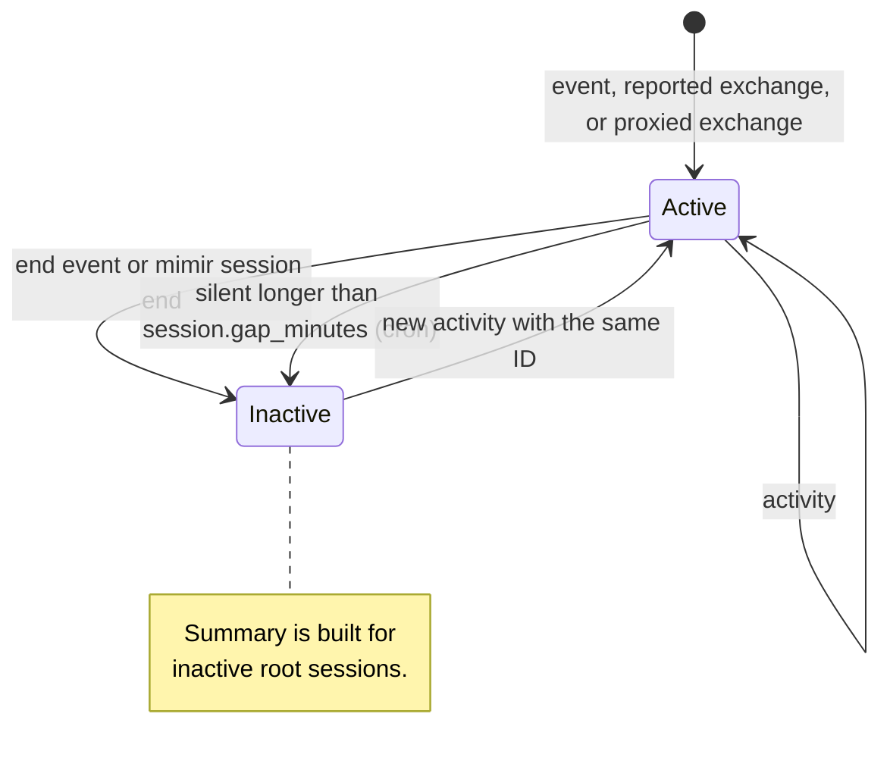

# Session Lifecycle And Harness Capture

Mimir combines capture paths into one session record in D1. The Worker proxy
persists full redacted OpenRouter exchanges. Pi, Oh My Pi, OpenCode, Hermes,
and the Claude Code, Codex, and Cursor hook adapter persist bounded exchanges
reconstructed from what the harness exposes, report lifecycle events, and
capture commits through `mimir _hook git`. Every route writes D1 directly;
there is no per-session coordinator.



`x-mimir-session` is the authoritative boundary. Without it, the proxy groups
traffic by repository, harness, and device with the `session.gap_minutes`
inactivity gap (default 15).

## Starting

Sessions start lazily from the first activity carrying their ID:

1. A harness start hook sends a heartbeat. Oh My Pi waits for the first real
   turn so an idle draft does not create a session. Hermes waits until
   direct-provider evidence activates the plugin.
2. The first completed turn or reported exchange arrives if the start hook was
   missed.
3. The first proxied request carrying `x-mimir-session` is captured.

Installing Mimir or launching an idle harness creates nothing.

## Ending

A session becomes inactive through any of three triggers:

1. **End event.** OpenCode sends it for `session.deleted`; Pi and Oh My Pi on
   shutdown; Hermes on finalize; Claude Code, Codex, and Cursor on their
   session-end hooks.
2. **Explicit end.** `mimir session end <id>` (`POST /sessions/:id/end`).
3. **Expiry.** The cron trigger, every 10 minutes, marks sessions silent longer
   than `session.gap_minutes` inactive. This covers crashes, killed terminals,
   sleep, and network loss.

Ending is idempotent. Retried turns are deduplicated by exchange ID, and a
heartbeat timestamped before the end cannot reopen the session.

## Reopening

Inactive is not a tombstone. New activity carrying the same session ID makes it
active again with its history intact, so a user can resume a conversation after
a clean end, an expiry, sleep, or disconnection. A genuinely new harness
session uses a new ID.

## Summaries

When a root session and its supporting sessions are all inactive, Mimir builds a
deterministic summary from saved evidence: goal, actions, result, verification,
open items, and evidence links. It is built right after an explicit end or
`end` event, and by the cron trigger for expired sessions or sessions whose new
saved exchanges marked the summary pending. No model call is made, and summary
claims are evidence to check, not proof.

## Git Status

Commits are captured as they happen. After a shell tool prints a
`git commit` confirmation, the integration runs `mimir _hook git`, which posts
the commit's redacted patch and whether it is already on a remote-tracking
branch. At turn or session end the integration re-checks the session's
unpushed commits and marks newly pushed ones. Each session's `git_status` is
`pushed` when any saved commit in its subtree is pushed, `committed` when it has
saved commits, and `none` otherwise.

## Capture Responsibilities

| Component | Responsibility |
| --- | --- |
| Worker proxy | Stream upstream responses; redact and persist full exchanges to R2/D1; index them for search |
| Pi and Oh My Pi extensions | Route OpenRouter through Mimir with exact session headers; persist bounded direct-provider turns; report heartbeats, titles, sub-agent parents, and end; capture commits |
| OpenCode plugin | Persist bounded direct-provider exchanges; report turns, heartbeats, titles, and end; capture commits; expose `mimir_*` tools |
| Hermes plugin | For direct providers, report bounded request/response reconstructions with tool activity, heartbeat, and end; leave proxied requests to the Worker; capture commits; expose `mimir_*` tools |
| Claude Code, Codex, and Cursor hooks | Pair prompt/completion hooks into bounded exchanges, report failures and start/end events, capture commits after shell tools, re-check pushed commits; Codex also reads transcript usage |
| Worker cron | Expire silent sessions, build summaries, backfill the search index |
| CLI and MCP | Query surface for agents; deployment and diagnostics |
| Dashboard | Access-protected Day, Sessions, and Devices pages over the same query API |

Event payloads carry summaries and excerpts, not transport archives.
Reconstructed exchanges are persisted and searchable after Worker redaction,
but contain only what the harness exposes and may omit tool activity, transport
metadata, token use, or timing. Only traffic through the Worker proxy produces a
full redacted transport exchange.

## Persistence

Transport success is not proof that an exchange was saved. The receipt is:

```bash
mimir session status <id>
```

It reflects stored state when asked and distinguishes saved, pending, partial,
failed, and uncaptured sessions. Capture state says nothing about whether the
work succeeded.
